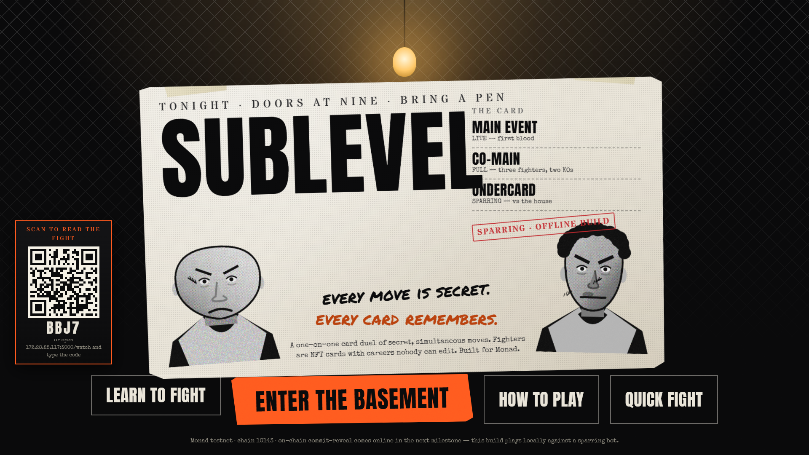
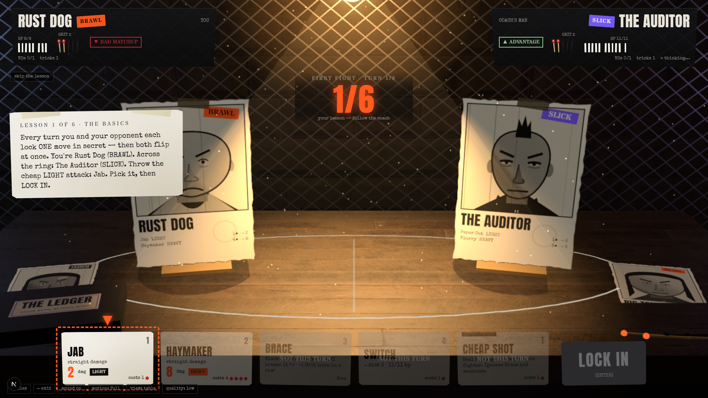
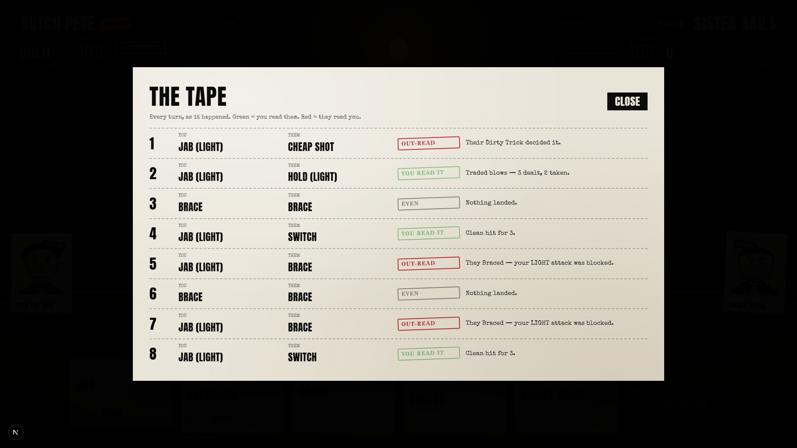
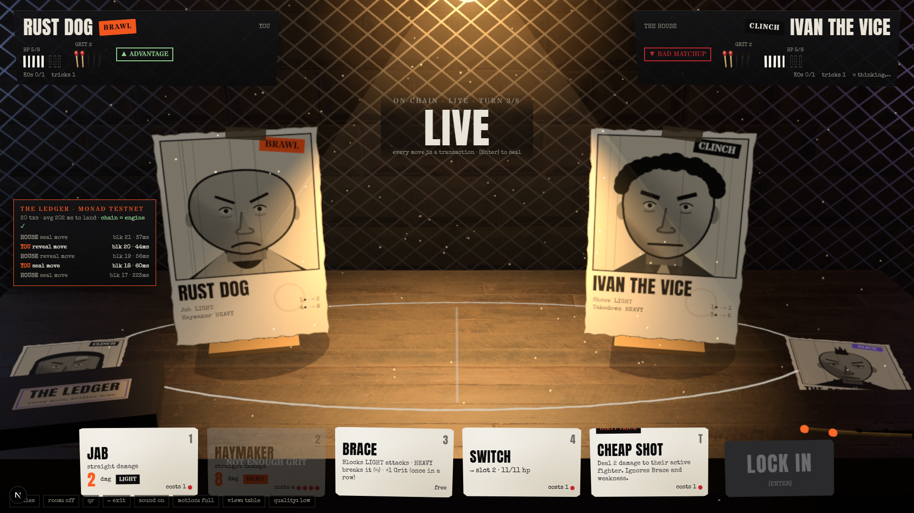
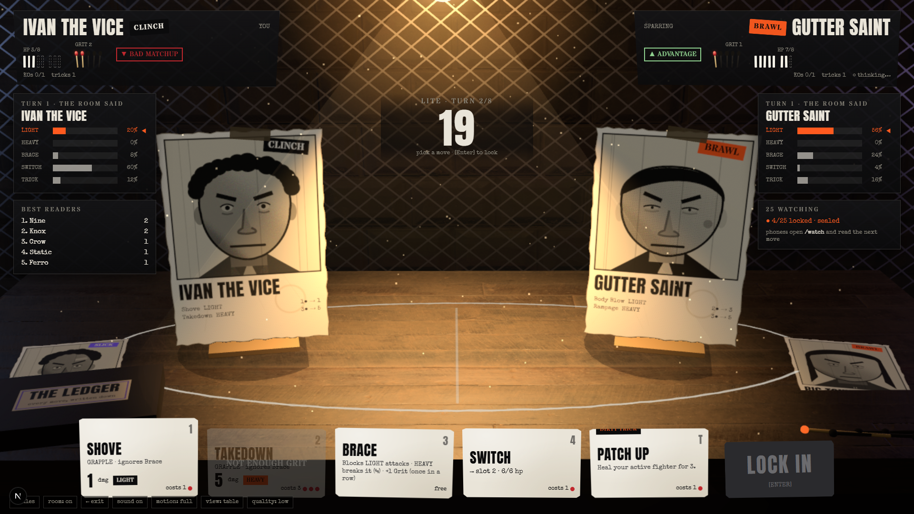
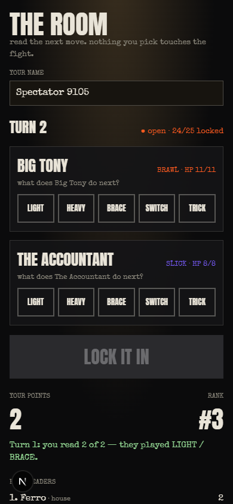

# SUBLEVEL

### An underground fight-club card duel on Monad.

Two fighters seal a move at the same moment. Nobody can see the other's, nobody can change theirs, and a contract resolves the turn. Fighters are NFTs whose careers nobody can edit, and a whole room can read the fight live from their phones without ever touching the result.

Built at **Monad Blitz Pune V3**.



## Links

| | |
|---|---|
| **Live app** | **https://sublevel-theta.vercel.app** |
| **Repository** | https://github.com/Hackmaass/Sublevel |
| **Network** | Monad Testnet (chain id `10143`) · explorers: [Monadscan](https://testnet.monadscan.com) · [MonadVision](https://testnet.monadvision.com) |
| **Contracts** | deployed and source-verified, see the table below |
| **Deployment** | one transaction, [`0x0f12d1db…3d7873`](https://testnet.monadscan.com/tx/0x0f12d1dbfa0f2c0a47bbaecdc5ad07cdccfe6f147376da80cc1c1326363d7873), block 69,789,792 |

### Deployed contracts (Monad Testnet, chain `10143`)

| Contract | Address | Role |
|---|---|---|
| **Arena** | [`0x4e8a6874dC1c607721191f93B76156c30355294b`](https://testnet.monadscan.com/address/0x4e8a6874dC1c607721191f93B76156c30355294b) | commit → reveal bouts, timeouts, forfeits, settlement |
| Cards | [`0xb04f5d938e92563FC48aC9acF7fc367527BC9dcD`](https://testnet.monadscan.com/address/0xb04f5d938e92563FC48aC9acF7fc367527BC9dcD) | ERC-721 fighters and tricks; records written only by the Arena |
| Armory | [`0xff8425F545Cf2EB51B0604F227ba842d52109453`](https://testnet.monadscan.com/address/0xff8425F545Cf2EB51B0604F227ba842d52109453) | pools of cards, scoped session keys |
| Ladder | [`0x327b300ac0EFaF463a5363Fd3f4d9F5b55525788`](https://testnet.monadscan.com/address/0x327b300ac0EFaF463a5363Fd3f4d9F5b55525788) | Elo ratings and the Belt (soulbound to the reign) |
| Bootstrap | [`0x45fCCe56c139b28655A3b7083f98e41C6c36E04d`](https://testnet.monadscan.com/address/0x45fCCe56c139b28655A3b7083f98e41C6c36E04d) | created the four above in one transaction and wired them, then holds no power |

All five are **source-verified** on both explorers (Monadscan: "Pass – Verified"; MonadVision: verified). The Arena, Cards, Armory and Ladder addresses were read back from the Bootstrap contract's own getters, and each contract's `arena()` / `ladder()` / `armory()` pointers were checked on chain. Deployment cost: 17,844,533 gas (Monad charges the gas *limit*) ≈ 1.82 MON at ~102 gwei.

## The game in a minute

**A turn.** Both fighters secretly choose one action, lock it in, and then both are revealed at once and resolved.

| Action | What it does |
|---|---|
| **Attack** | Spend Grit to hit. Each fighter carries one **LIGHT** attack (cost 1–2) and one **HEAVY** attack (cost 3+). |
| **Brace** | A guard that gains Grit. |
| **Switch** | Swap in the fighter from your Corner (free if the other side didn't attack). |
| **Dirty Trick** | A one-shot card: heal, steal Grit, a cheap shot. |

**The triangle that makes it a mind-game:** **Brace beats LIGHT · HEAVY beats Brace · LIGHT beats HEAVY.** On top of that, fighters have styles: **BRAWL beats CLINCH beats SLICK beats BRAWL**. Everyone earns +1 Grit a turn (capped at 5), so spending a lot now means being empty next turn. A bout (Lite) is two fighters and a trick each, and the first KO wins, in about a minute.

Predictable players lose, so you have to read the other side: their Grit, their last move, whether they're turtling or about to go heavy.

| Learn to fight (scripted, six turns) | The tape: who read whom |
|---|---|
|  |  |

## Why it's on-chain (what breaks if this were a database?)

- **A referee nobody has to trust.** Commit–reveal means neither player can see or change a move after sealing, and the contract resolves it. There is no server that could peek at your move or favour a side.
- **Careers nobody can edit.** A card's wins, losses and scars are written only by the Arena, from a finished bout. There is no admin who can rewrite a record.
- **A title nobody can quietly reassign.** The Belt moves only when the holder loses a ranked bout.
- **No randomness.** There's no random number to game. (The contracts hold no money today; a testnet entry fee and crowd pool are designed, see [below](#proposed-the-ring-fee-and-the-crowd-pool-designed-not-built).)

## The ON-CHAIN DUEL

Press **⛓ ON-CHAIN DUEL** on the title screen. A **guest wallet** (a throw-away key generated in your browser) signs every move, so there are no wallet popups and you don't need a wallet of your own. The opponent is the house bot with its own wallet. Fund the guest wallet once from the faucet and press start.

Every seal and every reveal is a real transaction on Monad. **The Ledger** lists each one: who sent it, what it was, which block, and how many milliseconds it took to land. The UI narrates each turn with the TypeScript rules engine, then compares the result with the state the **contract** holds, and flags any difference. The Ledger shows `chain = engine ✓` while they agree.



*(Screenshot taken on a local test chain; testnet captures are added after the deploy.)*

## The Room

Street Aura's lesson, our way: the crowd takes part in the show but never in the result.

Spectators predict what **kind** of move each fighter will play next (LIGHT, HEAVY, BRACE, SWITCH or TRICK) and score points for correct reads. Picks are **sealed** while the turn is being decided, so the fighters can't use the crowd as a hint, and they're **revealed one turn late**, then scored. The big screen shows the room's read as heat bars and a roar when most of the room called it. Today only points and cosmetics are at stake, and the crowd can never change a bout.

| The big screen | A spectator's phone |
|---|---|
|  |  |

**Scan to join:** the big screen shows a QR code (large over a dimmed screen for the first seconds of a match, then docked as a small chip you can click to enlarge). Phones scan it, pick a name and join. No wallet needed. It works on the **live site** (phones connect to the projector peer-to-peer over WebRTC) and in **venue mode** (`pnpm web:demo`, a local relay).

## Proposed: the ring fee and the crowd pool (designed, not built)

> **Status: design only.** The deployed contracts have no `payable` function and hold no money. Nothing below is live, and nothing in the app claims it is. If built, it would be **testnet MON only** (no value); real money would need legal review first, because pooled wagering is regulated in India.

**1. Pay to enter the ring.** Each fighter puts the same entry fee into the bout, and the winner takes the pot.

| Event | What the Arena does with the pot (2 × fee) |
|---|---|
| Challenge created | The creator's fee is escrowed (`createChallenge{value: fee}`); cancelling before anyone accepts refunds it |
| Challenge accepted | The opponent sends the same fee (`acceptChallenge{value: fee}`); the bout starts with both fees locked |
| KO / bout won | The whole pot is credited to the winner |
| Opponent forfeits (bad reveal or missed deadline) | The pot goes to the player who played by the rules |
| Both miss a deadline (void) | Each gets their own fee back |

Winnings are **credited, then pulled** (`withdraw()`), never pushed in the middle of resolving a turn, so a hostile receiver can't re-enter the Arena. Fixed fee tiers, no admin and no house cut, in keeping with the contracts' no-owner rule.

**2. The crowd pool.** Spectators who want a stake buy into a bout's pool (a fixed entry, before turn 1). It is separate from the fighters' pot and has no way to influence the bout.

- **Who:** anyone except the two fighters and their session keys.
- **Predictions:** exactly as in The Room: per turn, one of five classes for each fighter, sealed as a hash while the turn is being decided, revealed one turn late. One transaction per spectator per turn (`reveal(t-1)` + `commit(t)`), which fits Monad's one-transaction-per-~3-blocks limit for low-balance wallets.
- **Scoring (on chain):** +1 per correctly read fighter per turn (max 2 a turn), computed from a small per-turn action log the Arena would keep. An unrevealed prediction scores nothing.
- **Payout:** when the bout ends, the pool is split among spectators in proportion to their points (a tie splits evenly). If nobody scored, every entry is refunded. Credited, then pulled, like the fighters' pot.

```
 fighter A fee ──┐                                   ┌──► winner (pot = 2 × fee)
                 ├─► Arena escrow ── bout result ───┤
 fighter B fee ──┘                                   └──► void: each fee back

 spectator entries ─► Crowd pool ── final scores ───► split by points (no scorers: refund)
        (separate from the pot; reads the Arena's action log, never writes to a bout)
```

**Known problems to solve before real use.** With value in the pool, a fighter could join as a spectator from a second wallet: they can't see the other fighter's sealed move, but they do know their own, which makes half of every read free. Entry caps per wallet and closing entries before turn 1 reduce this but don't remove it, and one person can still hold many wallets. This is why the live Room stays points-only for now.

## Try it in one minute

1. Open the live app and press **LEARN TO FIGHT**: a six-turn scripted bout on the real engine, fully offline.
2. Press **QUICK FIGHT** to spar the house bot, then open **THE TAPE** on the result screen.
3. Press **⛓ ON-CHAIN DUEL**, fund the guest wallet from [the faucet](https://faucet.monad.xyz) and press **START THE DUEL**.
4. Scan the QR on the big screen with your phone (or open **`/watch`** in a second window) to read the fight as a spectator.

## What is built, and what is not

**Built and working**
- **Rules engine** (`packages/engine`): pure TypeScript, integer-only, Rulebook v1; bots, a simulator and the "depth gate" that picked the rules. 54 tests and 1,541 cross-language vectors.
- **Contracts** (`contracts/`): `Engine` (a line-for-line port of the TS rules), `Arena` (commit–reveal for Lite and Full hidden-hand bouts), `Cards`, `Armory`, `Ladder`. 63 Foundry tests, including whole bouts replayed through the contracts and checked against the TypeScript engine.
- **The web app** (`apps/web`): the 3D tabletop with a flat fallback, the learn-to-fight tutorial, the post-bout tape, the Room (host screen and phones, with QR join on the live site), wallet sign-in and the **Belt** screen (read from the deployed Ladder), the one-transaction **deploy page**, and the on-chain duel with its Ledger.
- **Tooling**: a client library that plays full bouts through the contracts (`packages/chain`), tested on a local chain; a script that publishes source for all five contracts through the Monad verification API.

**Not built / not live (Because we are constrained by demo enviroment)**
- The on-chain duel plays the **Lite** format against a house bot. The Full format (3v3, hidden hands) is implemented and tested in the contracts but isn't wired into the UI.
- The **ranked queue and the Belt** are implemented and tested in the contracts. The Belt screen shows them live, but both belts are vacant on testnet because the on-chain duel is unranked; there is no ranked-queue UI yet.
- The Room's scoring runs **off-chain** in the host browser (a mock referee). An on-chain `Crowd` contract is designed but not written.
- **Money is not built.** The **ring entry fee** (winner takes the pot) and the **crowd pool** (split by prediction points) are designed [above](#proposed-the-ring-fee-and-the-crowd-pool-designed-not-built) but not written, tested or deployed. The deployed contracts hold no funds.
- This is because for the crowd review, every phone that connects would need a wallet configured, also for the duel to happen again the wallet would need to be configured. and would need more testnet tokens as this is not handled by a gamer server rather fully reliant on the monad chain

## Run it yourself

Needs Node 20+ and pnpm. **Foundry is not needed to run the app.**

```bash
git clone https://github.com/Hackmaass/Sublevel.git && cd Sublevel
pnpm install
pnpm web:dev                      # http://localhost:3000 (the tutorial and sparring work offline)
pnpm engine:test                  # rules engine tests
```

**Contracts** (needs [Foundry](https://getfoundry.sh); `forge-std` and OpenZeppelin are vendored in `contracts/lib`):
```bash
cd contracts && forge test        # 63 tests
```

**Deploy your own copy to Monad Testnet** (no CLI, and no key leaves your wallet): open **`/deploy`** in the running app and send the single deployment transaction from any wallet extension (each installed wallet is listed separately, so having MetaMask and Phantom installed together is fine) or from the built-in **guest wallet** with no extension at all. The contracts have no admin, so whichever account deploys gains no power. Note: Phantom's own docs list no Monad network, so use MetaMask, Rabby, OKX or the guest wallet. It costs about 17.7M gas; Monad charges the gas *limit*, so at the 100 gwei minimum fee that's roughly 2 MON. The page prints the five addresses. Put them into `apps/web/src/lib/deployments.ts` and the on-chain duel appears on the title screen.

**Publish the source on the explorers:** `pnpm --filter @sublevel/chain verify <bootstrapAddress>` (it reads the other four addresses from the Bootstrap contract and uses the exact compiler settings of the build).

**Venue mode** (a projector and phones): `pnpm web:demo` serves a production build on every network interface. Open `http://localhost:3000` on the big screen and phones that scan its QR join the Room. The phones must be able to reach the laptop (same wifi, or the laptop's hotspot). On the hosted site (sublevel-theta.vercel.app) there is no server to keep a room, so phones connect to the big screen peer-to-peer over WebRTC (PeerJS's free public signalling server only introduces them); the QR works there too, and it needs both devices to reach the internet and not be on a Wi-Fi that blocks device-to-device traffic.

## How it fits together

```
 browser (Next.js)                                   Monad testnet
 ┌──────────────────────────────┐   seal / reveal   ┌───────────────────────────────┐
 │ The Table (R3F + flat 2D)    │──────────────────►│ Arena  ◄── Engine (rules)     │
 │ engine (TS rules, bots)      │◄──── state ───────│ Cards (ERC-721, records)      │
 │ guest wallet + house bot     │                   │ Armory (pools, session keys)  │
 │ THE LEDGER (tx, block, ms)   │                   │ Ladder (Elo, the Belt)        │
 └─────────────┬────────────────┘                   └───────────────────────────────┘
               │ QR + WebRTC (live site) or SSE relay (venue mode), off-chain
               ▼
        spectator phones (/watch): read the fight, points only
```

**Fairness.** A commit is `keccak(chain, arena, bout, turn, phase tag, player, choice, salt)`. A reveal that doesn't match, or isn't legal, forfeits; a missed deadline forfeits; both sides missing voids the bout. After deployment nobody holds any power: `Bootstrap` wires everything inside its own constructor. The full trust model and known limits are in [`contracts/README.md`](contracts/README.md).

## Why Monad

Commit–reveal, NFTs and escrow work on any EVM chain. What Monad changes is that a **per-turn on-chain mind-game can feel real-time**: ~0.3–0.4 s blocks and sub-second finality turn "seal, wait for the other seal, reveal, resolve" into a few seconds per turn instead of a minute, and gas is cheap enough for a few dozen transactions per bout. Two Monad rules shaped the client, and both are handled in `packages/chain/src/duel.ts`:

- **Gas is charged on the limit, not on what's used,** so each call estimates its own gas with only a small buffer.
- **A wallet under 10 MON gets one transaction per ~3 blocks,** so the client spaces its own transactions.

The verified chain facts, and where each one came from, are in [`docs/TECH_ARCHITECTURE.md`](docs/TECH_ARCHITECTURE.md).

## Market and revenue (an honest sketch)

- **Who it's for:** crypto-native communities and events that want a live, watchable game in the room (hackathons, meetups, campus and Discord communities), and card-duel players who want provable fairness and a permanent record.
- **What could earn:** event licensing of the Room (a host runs a projector night and the community plays); cosmetics and card art, never power; a small mint fee for custom fighters; sponsored belts and seasons. No pay-to-win ever. A testnet entry fee and crowd pool are designed (see above), but real-money wagering is a legal risk in India, so it would need legal review before any mainnet use.
- **What we have not proven:** any of this. There are no users yet.

## Repository map and design docs

`packages/engine` (rules, bots, simulator, tests) · `packages/chain` (viem client: commitments, secrets, seats, duel flow, verify script) · `apps/web` (Next.js 16, React 19, React Three Fiber) · `contracts/` (Foundry) · `docs/` · `ASSETS.md` (every external asset and its licence).

| File | What it covers |
|---|---|
| [`docs/HOW_TO_PLAY.md`](docs/HOW_TO_PLAY.md) | The player manual (tables generated from the rulebook) |
| [`docs/CARD_DUEL.md`](docs/CARD_DUEL.md) | The rules, Lite and Full formats, balance requirements, abuse rules |
| [`docs/NFT_AND_CHAIN.md`](docs/NFT_AND_CHAIN.md) | Card model, contracts, session keys, bout lifecycle |
| [`docs/TECH_ARCHITECTURE.md`](docs/TECH_ARCHITECTURE.md) | Verified chain facts, trust boundary, commit–reveal rules |
| [`docs/VISION.md`](docs/VISION.md) | Pillars, the game in five sentences, why Monad, the Room |
| [`docs/VISUAL_IMMERSION.md`](docs/VISUAL_IMMERSION.md) | "The Table": layout, diegetic UI, art pipeline |
| [`docs/PLAN.md`](docs/PLAN.md) | Phases, risks, cut list, decision log |
| [`docs/screenshots/`](docs/screenshots/) | What every feature looks like |
